# AdventureWorks Azure Data Engineering Project

An end-to-end, metadata-driven ETL pipeline on Azure using the **medallion architecture (Bronze → Silver → Gold)**. Raw CSV files are ingested with Azure Data Factory, cleaned and transformed with PySpark on Azure Databricks, and served through Azure Synapse serverless SQL as external tables for BI tools such as Power BI.

---

## Business Problem

**Scenario:** AdventureWorks is a bicycle retailer. Its data arrives as raw, disconnected CSV exports: three separate yearly sales files, customers, a product catalogue split across three files (products, subcategories, categories), returns, territories and a calendar table. This public sample dataset is used here to simulate a typical retail analytics situation.

**Problems this creates for analysts and BI teams:**

- Data is split across many files and has to be loaded by hand, which doesn't scale and is easy to get wrong.
- Raw columns are not analysis-ready (for example separate name parts, inconsistent order-number formats and untyped dates).
- Related tables (sales, products, customers) cannot be queried together through one governed, SQL-accessible layer.
- Every new source file would mean building and maintaining another pipeline.

**How this project solves it:**

| Problem | Solution built |
|---|---|
| Manual, per-file loading | A single **metadata-driven ADF pipeline** (Lookup + ForEach + Copy) ingests every file from a configuration file |
| Raw, inconsistent data | **PySpark transformations** in Databricks standardize and enrich the data, stored as Parquet in a Silver layer |
| No SQL-friendly curated layer | **Synapse serverless SQL** views and **external tables** publish a Gold layer that analysts and Power BI can query directly |
| Insecure or ad hoc access | Authentication through a **service principal** (Databricks) and a **managed identity** (Synapse), with RBAC roles on the storage account |

**Outcome:** 10 raw CSV files become 8 curated Silver datasets and 8 Gold external tables, queryable with standard SQL and ready for reporting. Adding a new source file only needs one new entry in the metadata file.

---

## Architecture

This project follows the **medallion architecture**, a layered data lake design that improves data quality step by step as it moves from Bronze to Silver to Gold. Each layer has its own container in Azure Data Lake Storage Gen2 and its own purpose.

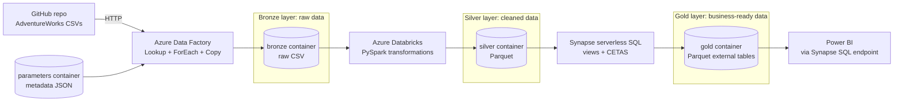

| Layer | Storage | Format | Built with | Purpose |
|---|---|---|---|---|
| **Bronze** | ADLS Gen2 `bronze` container | CSV | Azure Data Factory | Raw data stored exactly as ingested, with no changes |
| **Silver** | ADLS Gen2 `silver` container | Parquet | Azure Databricks (PySpark) | Cleaned, typed and enriched data |
| **Gold** | ADLS Gen2 `gold` container | Parquet | Synapse serverless SQL (CETAS) | Business-ready tables exposed as external tables for SQL and BI tools |

---

## Tech Stack

| Area | Technology |
|---|---|
| Orchestration / ingestion | Azure Data Factory (Lookup, ForEach, Copy activity, parameterized datasets) |
| Storage | Azure Data Lake Storage Gen2 (hierarchical namespace) |
| Transformation | Azure Databricks, PySpark (Spark 3.5.0, Runtime 14.3 LTS) |
| Serving layer | Azure Synapse Analytics, serverless SQL pool |
| Authentication | Microsoft Entra ID app registration (service principal), Synapse managed identity |
| Consumption | Power BI Desktop connected to the Synapse serverless SQL endpoint |
| Source control | Git / GitHub |

---

## Dataset

AdventureWorks sample data (10 CSV files): Calendar, Customers, Product Categories, Product Subcategories, Products, Returns, Sales 2015, Sales 2016, Sales 2017 and Territories. The files live in the `Data/` folder of this repository, which acts as the pipeline's source system.

---


## Implementation Walkthrough

### 1. Azure environment setup

- Created one resource group (`ADWPROJECT`) that holds all project resources.
- Created an **ADLS Gen2** storage account with four containers: `bronze`, `silver`, `gold` and `parameters`.
- Deployed Azure Data Factory, an Azure Databricks workspace (Premium tier) and a Synapse workspace.

**Figure 1: Data Lake containers**

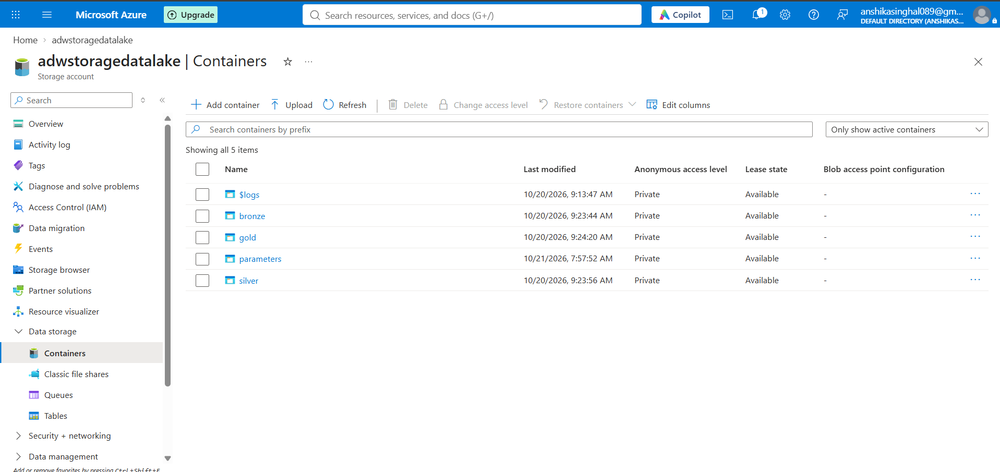

*The four containers in the ADLS Gen2 storage account that make up the medallion layers and the metadata store.*

### 2. Ingestion with Azure Data Factory (Bronze)

Instead of one Copy activity per file, I built a **metadata-driven pipeline** (`DynamicGitToRaw`):

- A **Lookup** activity reads a parameters JSON file from the `parameters` container.
- A **ForEach** activity loops over every entry in that file.
- Inside the loop, a **Copy** activity pulls each CSV from GitHub and writes it to its own folder in the `bronze` container.
- Source and sink datasets are **parameterized**, and values are passed with dynamic expressions such as `@item().p_sink_folder` and `@item().p_file_name`.

Each entry in the parameters file looks like this:

```json
{
    "p_rel_url": "<github-username>/AdventureWorks_Data_Engineering_Project/refs/heads/main/Data/AdventureWorks_Calendar.csv",
    "p_sink_folder": "AdventureWorks_Calendar",
    "p_file_name": "AdventureWorks_Calendar.csv"
}
```

Adding a new source file needs only a new entry in this file, with no pipeline changes. I first built a simple hardcoded version (`GitToRaw`) and then refactored it into the dynamic version.

**Figure 2: Pipeline design**

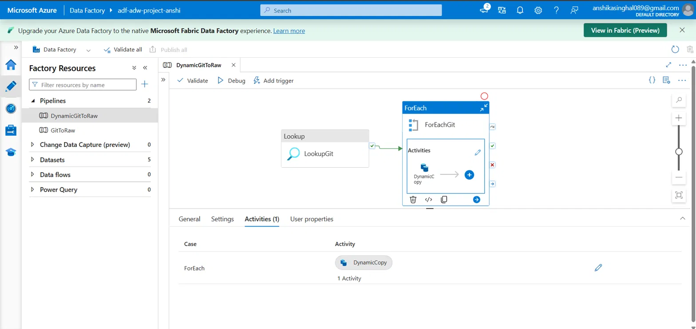

*The Lookup activity feeds the ForEach loop, which contains the Copy activity.*

**Figure 3: Parameterized Copy activity**

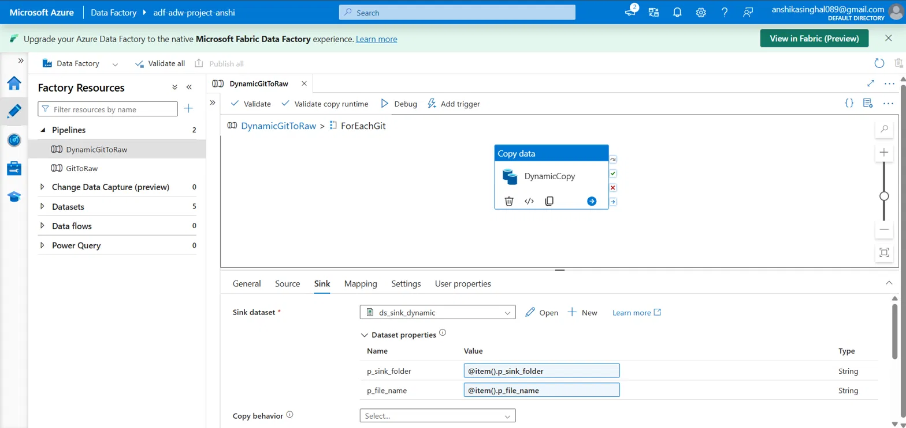

*The sink dataset receives its folder and file name from the current loop item through dynamic expressions.*

**Figure 4: Successful pipeline run**

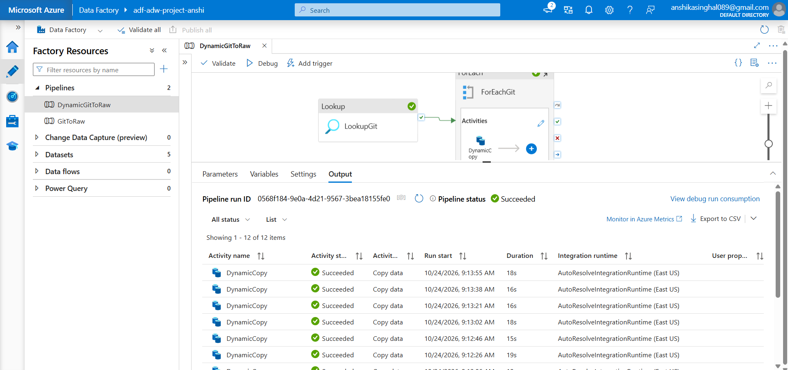

*A run in which the Lookup, ForEach and all 10 Copy activities completed successfully.*

**Figure 5: Bronze layer output**

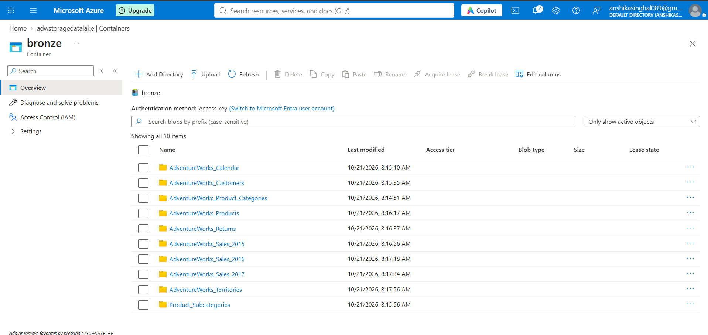

*The pipeline creates one folder per source file, with the raw CSV inside.*

### 3. Secure access from Databricks to the Data Lake

Databricks authenticates to ADLS Gen2 as a **service principal**:

1. Registered an application in **Microsoft Entra ID** (app registration).
2. Created a **client secret** with a 180-day expiry.
3. Assigned the application the **Storage Blob Data Contributor** role on the storage account through Access control (IAM).
4. Configured the Spark session for **OAuth 2.0 client credentials** through the ABFS driver:

```python
spark.conf.set("fs.azure.account.auth.type.<storage-account-name>.dfs.core.windows.net", "OAuth")
spark.conf.set("fs.azure.account.oauth.provider.type.<storage-account-name>.dfs.core.windows.net", "org.apache.hadoop.fs.azurebfs.oauth2.ClientCredsTokenProvider")
spark.conf.set("fs.azure.account.oauth2.client.id.<storage-account-name>.dfs.core.windows.net", "<application-client-id>")
spark.conf.set("fs.azure.account.oauth2.client.secret.<storage-account-name>.dfs.core.windows.net", "<client-secret-value>")
spark.conf.set("fs.azure.account.oauth2.client.endpoint.<storage-account-name>.dfs.core.windows.net", "https://login.microsoftonline.com/<directory-tenant-id>/oauth2/token")
```

All real credentials are replaced with placeholders in this repository.

### 4. Transformation with Databricks and PySpark (Silver)

**Compute:** a single-node all-purpose cluster (`Standard_D4ds_v4`, 16 GB, 4 cores) on Runtime 14.3 LTS, with Photon off and auto-termination after 15 minutes to control cost.

**Process:** the notebook reads each raw CSV from `bronze`, applies transformations to make the data analysis-ready, and writes the result as **Parquet** to `silver`. The three yearly sales files are consolidated into one sales dataset, so 10 bronze folders become 8 Silver datasets.

| Table | Transformation | Purpose |
|---|---|---|
| Calendar | `month()` and `year()` to add `Month` and `Year` columns | Enables time-based analysis |
| Customers | `concat_ws` to build `FullName` from `Prefix`, `FirstName` and `LastName` | Single display name that handles missing parts |
| Products | `split()` to shorten `ProductSKU` and `ProductName` | Cleaner, consistent product identifiers |
| Sales | `regexp_replace` on `OrderNumber` | Standardizes the order-number format |
| Sales | `to_timestamp` on `StockDate` | Converts the date text into a proper timestamp type |
| Sales | `Multiply` column (`OrderLineItem × OrderQuantity`) | Derived measure for analysis |

The pattern is the same for every table: **read from Bronze, transform, write to Silver.**

```python
# 1. Read raw CSV from Bronze
df_cust = (spark.read.format("csv")
             .option("header", True)
             .option("inferSchema", True)
             .load("abfss://bronze@<storage-account-name>.dfs.core.windows.net/AdventureWorks_Customers"))

# 2. Transform (example: build a full name, skipping null parts)
df_cust = df_cust.withColumn("FullName", concat_ws(" ", col("Prefix"), col("FirstName"), col("LastName")))

# 3. Write to Silver as Parquet
(df_cust.write.format("parquet")
        .mode("append")
        .option("path", "abfss://silver@<storage-account-name>.dfs.core.windows.net/AdventureWorks_Customers")
        .save())
```

The complete notebook with every transformation is in [`Notebooks/silver_layer.ipynb`](Notebooks/silver_layer.ipynb).

**Figure 6: Reading raw data from Bronze**

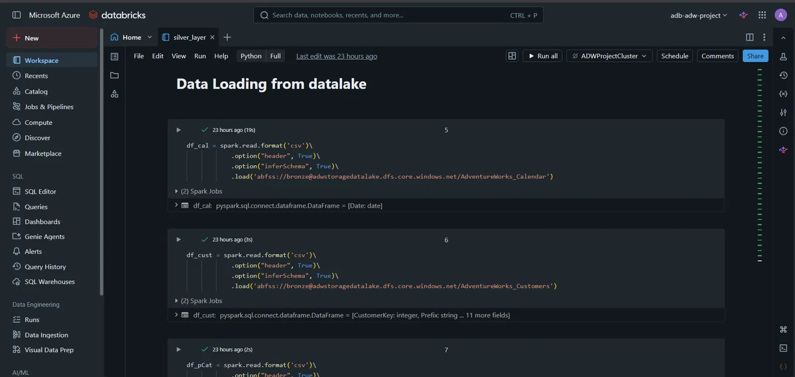

*Cells that load the raw CSV files from the bronze container into Spark DataFrames.*

**Figure 7: Calendar transformation**

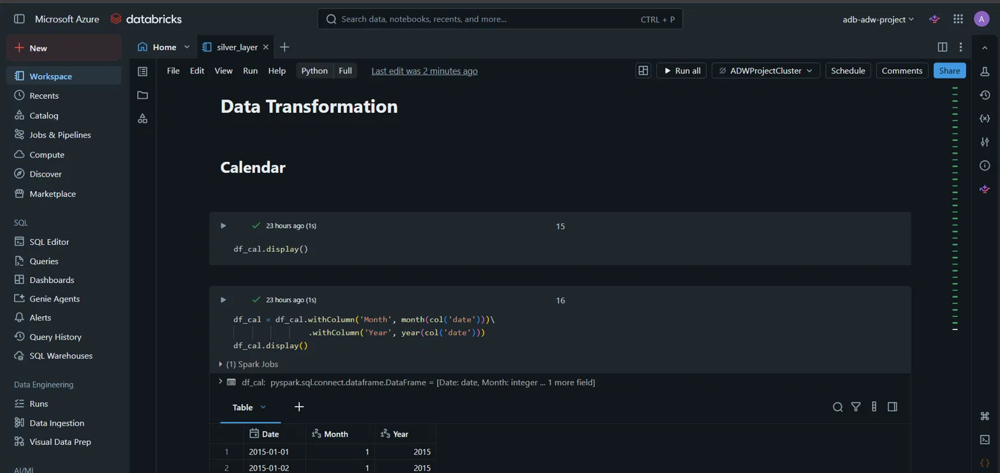

*Month and Year columns derived from the date column, with the output table.*

**Figure 8: Sales transformation and write to Silver**

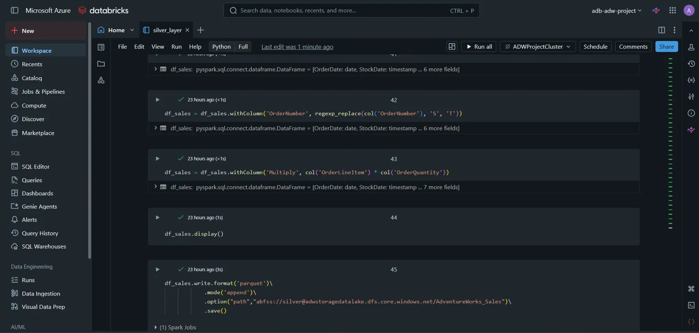

*Order number cleansing, the derived `Multiply` column, and the Parquet write to the silver container.*

**Figure 9: Sales analysis**

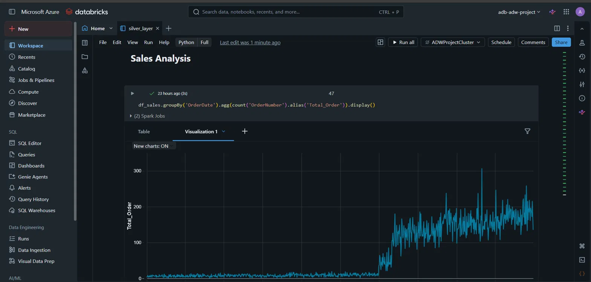

*Daily order counts over time, used to validate the cleaned sales data.*

**Figure 10: Silver layer output**

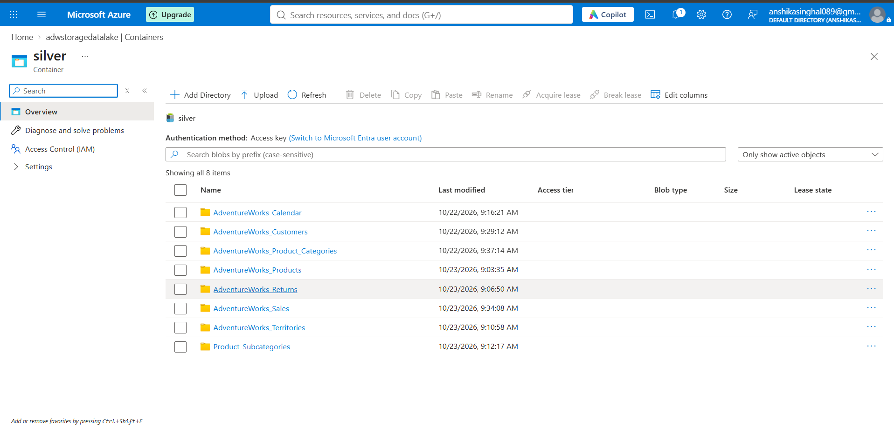

*The 8 cleaned datasets stored as Parquet in the silver container.*
### 5. Serving layer with Synapse serverless SQL (Gold)

In a Synapse serverless SQL database:

1. Created a `gold` schema.
2. Created **8 views** over the Silver Parquet files with `OPENROWSET`:

```sql
CREATE VIEW gold.calendar
AS
SELECT *
FROM OPENROWSET(
    BULK 'https://<storage-account-name>.dfs.core.windows.net/silver/AdventureWorks_Calendar/',
    FORMAT = 'PARQUET'
) AS QUERY_Cal;
```

3. Set up storage access with the **workspace managed identity**:

```sql
CREATE MASTER KEY ENCRYPTION BY PASSWORD = '<your-strong-password>';

CREATE DATABASE SCOPED CREDENTIAL cred_adw
WITH IDENTITY = 'Managed Identity';

CREATE EXTERNAL DATA SOURCE source_gold
WITH (LOCATION = 'https://<storage-account-name>.dfs.core.windows.net/gold/', CREDENTIAL = cred_adw);

CREATE EXTERNAL FILE FORMAT format_parquet
WITH (FORMAT_TYPE = PARQUET, DATA_COMPRESSION = 'org.apache.hadoop.io.compress.SnappyCodec');
```

4. Used **CETAS (CREATE EXTERNAL TABLE AS SELECT)** to write 8 external tables as Parquet into the `gold` container:

```sql
CREATE EXTERNAL TABLE gold.extsales
WITH (
    LOCATION    = 'extsales',
    DATA_SOURCE = source_gold,
    FILE_FORMAT = format_parquet
)
AS
SELECT * FROM gold.sales;
```

**Figure 11: Gold views**

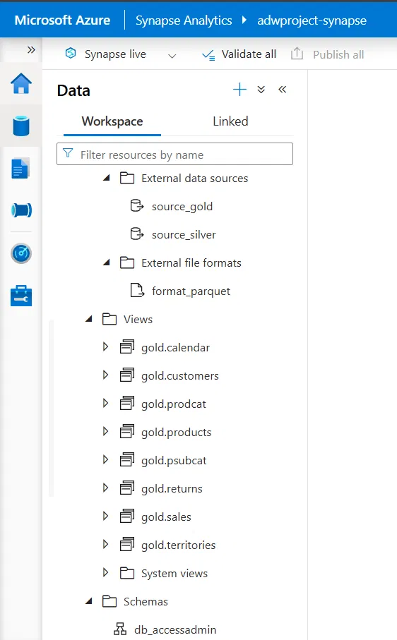

*The 8 views that expose the Silver Parquet files through SQL.*

**Figure 12: External tables**

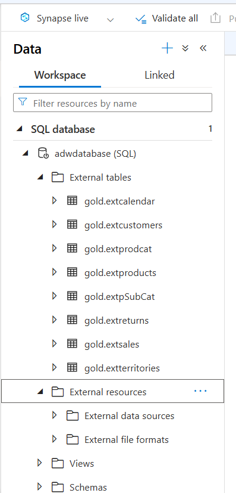

*The 8 external tables created with CETAS.*

**Figure 13: Gold layer in the Data Lake**

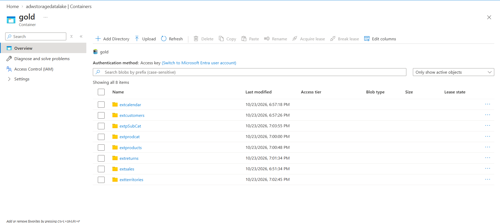

*CETAS wrote one Parquet folder per external table into the gold container.*

**Figure 14: Querying the Gold layer**

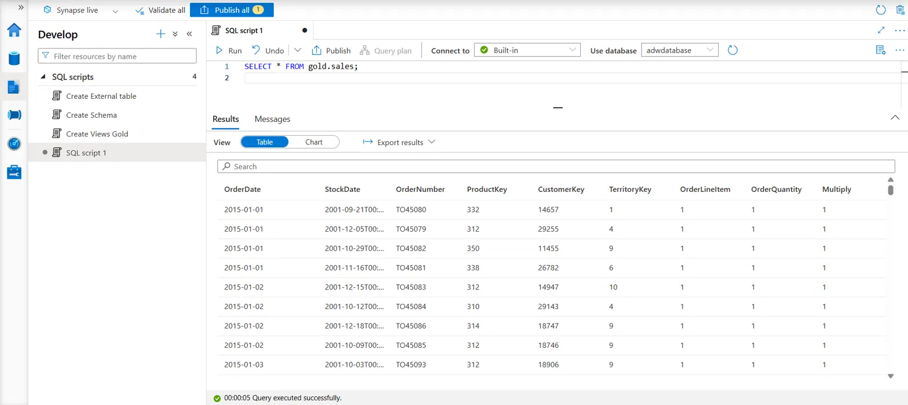

*A standard SQL query on the sales data returning the transformed columns.*

### 6. Consumption: connecting Power BI to Synapse

Power BI Desktop reads the Gold layer through the Synapse **serverless SQL endpoint**:

1. In Power BI Desktop, choose **Get Data → SQL Server database**.
2. For **Server**, enter the serverless endpoint of the Synapse workspace: `<synapse-workspace-name>-ondemand.sql.azuresynapse.net`.
3. For **Database**, enter the Synapse serverless database name.
4. Sign in with the **Database** (SQL authentication) option, using the SQL administrator login set when the workspace was created.
5. In the Navigator, select the Gold-layer external tables and load them into the Power BI data model.

The external tables are backed by the Parquet files in the `gold` container, so Power BI reads curated data through standard SQL, with no direct access to the storage account.

---

## Repository Structure

```
├── Data/                 # Source CSV files (pipeline source)
├── ADF_Pipeline/         # Pipeline definition (JSON) and parameters (metadata) file
├── Notebooks/            # Databricks notebook (Silver layer transformations)
├── Synapse_SQL/          # SQL scripts: schema, views, credential, external tables
├── images/               # Screenshots of every stage
└── README.md
```

---

## Key Concepts Demonstrated

| Concept | Where it appears |
|---|---|
| Medallion architecture | Bronze, Silver and Gold containers |
| Metadata-driven pipelines | Lookup + ForEach + parameterized datasets in ADF |
| Service principal authentication | App registration, client secret and RBAC role for Databricks to ADLS |
| Managed identity | Synapse credential used for the external data source |
| Role-based access control | Storage Blob Data Contributor assignments |
| ELT with PySpark | Reads, column transformations, type casting, Parquet writes |
| Data lake querying | Serverless SQL views with `OPENROWSET` |
| External tables / CETAS | Gold layer written to the lake as Parquet |
| BI connectivity | Power BI connected to the Synapse serverless SQL endpoint |
| Cost control | Auto-termination, single-node cluster, serverless pay-per-query SQL |

---

## Engineering Challenges and Resolutions

| Challenge | Root cause | Resolution |
|---|---|---|
| **Compute provisioning on a constrained subscription** | The Databricks Trial tier is not supported on free or student subscriptions, and the subscription's vCPU quota was fully consumed by a single 4-core cluster | Redeployed on the Premium tier, right-sized to one single-node cluster, disabled Photon, set 15-minute auto-termination and terminated the cluster after each session |
| **Synapse deployment blocked by regional provisioning policy** | The target region was not accepting new SQL servers for the subscription (`SqlServerRegionDoesNotAllowProvisioning`) | Diagnosed the error from the deployment details, redeployed the workspace in a region that allows it, and removed the orphaned storage accounts left by the failed deployments |
| **Non-idempotent writes producing duplicate Parquet files** | `append` mode adds a new part file on every rerun, which would silently duplicate rows in downstream views | Detected the extra part files by inspecting the storage container, cleared the target paths before reruns, and logged overwrite or Delta merge as the production fix (see Next Steps) |
| **Stale external tables and orphaned gold folders** | Table definitions and output folders from an earlier run no longer matched each other | Dropped the redundant external table definitions, deleted the stale folders and cleaned the exported scripts, so the gold container maps one-to-one to the 8 external tables |
| **Undefined DataFrame reference in the notebook** | The code referenced a DataFrame variable that no earlier cell created, which exposed an inconsistency in the source tutorial | Traced the variable lineage across cells, corrected the reference to the DataFrame the earlier cell actually created, and ran cells top to bottom after each cluster restart |
| **BI authentication constraint** | Power BI's Microsoft account option accepts only work or school (Entra ID) accounts, not personal accounts | Connected through SQL authentication to the Synapse serverless endpoint and used the external tables, which read storage through the managed identity credential |

---

## Security Practices

- No credentials, client secrets or passwords are committed. They appear as placeholders in the notebook and SQL scripts.
- Storage access uses RBAC roles: a service principal for Databricks and a managed identity for Synapse.
- The client secret has a 180-day expiry.
- Linked service definitions, which hold connection details, are not included in this repository.

---

## Cost Management

- Single-node Databricks cluster with **15-minute auto-termination**, terminated manually after each session.
- Synapse **serverless** SQL only (billed per data scanned), with no dedicated SQL pool.
- Resource group deleted after the project was documented, to stop all charges.

---

## Next Steps

- Move Silver writes to **Delta Lake** with overwrite or merge logic so reruns are fully idempotent.
- Run the Databricks notebook from the ADF pipeline and add a schedule trigger for end-to-end orchestration.
- Store secrets in **Azure Key Vault** (Databricks secret scope) instead of notebook variables.
- Add data quality checks (null, duplicate and referential checks) between layers.
- Extend the design to streaming ingestion with Auto Loader or Spark Structured Streaming.

---

## Acknowledgements

Built while following the "Azure End-to-End Data Engineering Project" tutorial by Ansh Lamba. I implemented and debugged everything in my own Azure subscription, including the environment setup, access configuration, error resolution and cleanup documented above.
